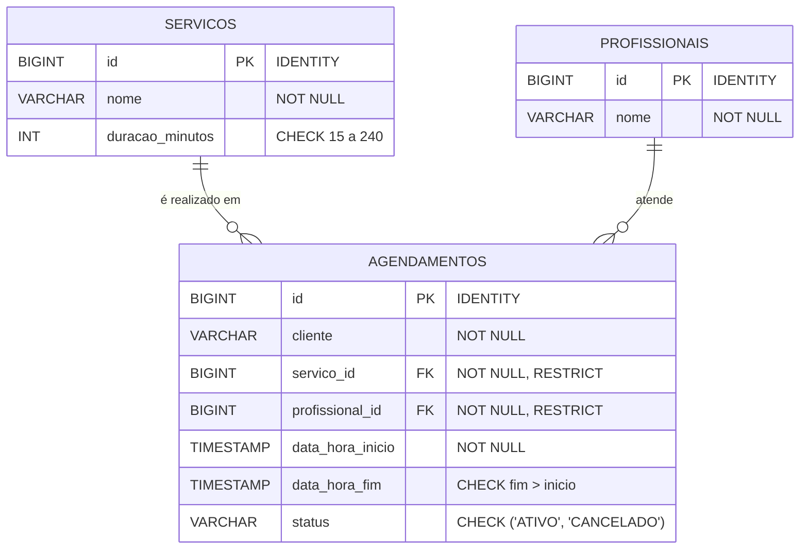

# Agenda do Salão-Escola

Projeto do Cloud Challenge para organizar os agendamentos do Salão-Escola e evitar conflitos de horário entre clientes e profissionais.

## Problema e objetivo

Os agendamentos feitos manualmente podem colocar dois clientes com a mesma profissional no mesmo horário. O sistema permitirá criar, consultar e cancelar agendamentos, além de mostrar a agenda diária de cada profissional.

## Equipe e responsabilidades

| Integrante | Papel principal | Responsabilidades |
|---|---|---|
| Joelson | DEV | Estrutura da aplicação, integração das funcionalidades e revisão técnica. |
| Tayana | DEV | Operações de agendamento, validações e regra de conflitos. |
| Homero | DADOS | Modelo relacional, restrições e scripts SQL. |
| César | DADOS | Dados iniciais fictícios, consultas e apoio à prova de persistência. |
| Lucas | NUVEM | Variáveis de ambiente, configuração e implantação na Azure, conforme o nível atribuído. |
| Nicolas | QA e documentação | Casos de teste, evidências e documentação de execução. |
| Morgana | QA e documentação | README, revisão dos testes, evidências e apoio ao pitch. |

Esta distribuição é uma proposta inicial e pode ser ajustada pelo grupo. Todos devem conseguir explicar o fluxo da aplicação e do banco.

## Requisitos do desafio

- Carregar serviços, com suas durações, e profissionais fictícios por script SQL.
- Criar agendamentos com cliente fictício, serviço, profissional e horário inicial.
- Calcular o horário final com base na duração do serviço.
- Recusar com erro HTTP 409 agendamentos ativos que se sobreponham para a mesma profissional.
- Permitir agendamentos de segunda a sábado, entre 08:00 e 20:00, desde que o atendimento inteiro caiba nesse intervalo.
- Cancelar agendamentos por mudança de status, liberando o horário.
- Consultar a agenda de um dia por profissional.
- Persistir os dados em banco e disponibilizar `GET /health` para verificar a conexão.
- Validar entradas no servidor, retornar erros claros e usar consultas parametrizadas.
- Manter a string de conexão em `DATABASE_URL`; nunca versionar `.env` ou credenciais.

## Modelo de dados relacional

- `servicos`: identificador, nome e duração em minutos.
- `profissionais`: identificador e nome fictício.
- `agendamentos`: identificador, cliente fictício, referências ao serviço e profissional, início, fim e status.

O modelo relacional foi estruturado para evitar dados órfãos, garantir integridade referencial e possibilitar o histórico de agendamentos.



### Restrições e Integridade
- **Chaves Primárias e Estrangeiras**: Chaves primárias com auto-incremento padrão ANSI e chaves estrangeiras com `ON DELETE RESTRICT`, impedindo a remoção de serviços ou profissionais que possuam agendamentos vinculados (evita registros órfãos).
- **Validação de Duração**: `CHECK (duracao_minutos >= 15 AND duracao_minutos <= 240)`.
- **Validação de Intervalo Temporal**: `CHECK (data_hora_fim > data_hora_inicio)`.
- **Restrição de Estados**: `CHECK (status IN ('ATIVO', 'CANCELADO'))` com valor padrão `'ATIVO'`.

### Decisão: Onde é validada a sobreposição de horários?
- **Decisão**: A validação de sobreposição de horários é realizada na **Camada de Aplicação (`Service`)**, com controle transacional (`@Transactional`) e suporte a índices no banco de dados (detalhado em [ADR-006](docs/adr/backend/ADR-006-estrategia-banco-h2-e-validacao-sobreposicao.md)).
- **Tratamento de Concorrência**: Agendamentos simultâneos são isolados pela transação do Spring Boot, retornando `HTTP 409 Conflict` com payload padronizado caso uma sobreposição seja detectada.
- **Portabilidade**: Essa estratégia foi escolhida porque constraints de intervalo como `EXCLUDE USING gist` só existem no PostgreSQL, garantindo que a aplicação execute de forma idêntica no **H2 local**, no **Azure SQL** ou no **PostgreSQL**.

### Histórico de Cancelamentos
- Ao cancelar um atendimento, o registro é atualizado para `status = 'CANCELADO'`.
- A verificação de sobreposição filtra estritamente `WHERE status = 'ATIVO'`. Dessa forma, o horário cancelado é liberado imediatamente para nova marcação, mantendo o histórico de agendamentos preservado no banco para auditoria.

## Arquitetura e tecnologias

Fluxo previsto: cliente ou ferramenta HTTP → aplicação/API → banco relacional.

- Linguagem e framework: Java com Spring Boot.
- Banco de dados: H2 Database (scripts ANSI em `banco/schema.sql` e `banco/dados-iniciais.sql`, compatíveis com PostgreSQL e Azure SQL).
- Hospedagem: Azure App Service, conforme a atividade.
- Nível de implantação (A, B ou C): a confirmar com a distribuição do professor.

## Sprints

### Sprint 0 — Planejamento

Confirmar linguagem, banco e nível de implantação; registrar a arquitetura, as rotas, o modelo de dados, os papéis e os critérios de aceitação.

### Sprint 1 — Persistência

Criar schema e dados iniciais; configurar `DATABASE_URL`; implementar e verificar a gravação, consulta e cancelamento persistidos; preparar a prova de persistência após reinício.

### Sprint 2 — Regras, implantação e testes

Implementar e demonstrar a regra de conflitos, horário de funcionamento e agenda diária; implantar no nível atribuído; executar os testes; completar evidências, README e pitch.

## Critérios de aceitação principais

| Cenário | Resultado esperado |
|---|---|
| Ana tem atendimento das 14:00 às 14:30; novo horário para Ana às 14:15 | Recusar com 409 por sobreposição. |
| Ana tem atendimento até 14:30; novo horário para Ana às 14:30 | Aceitar, pois encostar no horário final não é conflito. |
| Bruno recebe agendamento às 14:15 enquanto Ana está ocupada | Aceitar, pois é outra pessoa profissional. |
| Cancelar o atendimento de Ana às 14:00 e agendar Ana nesse horário | Aceitar; o cancelamento libera o horário. |
| Serviço de 45 minutos às 19:45 ou tentativa de agendamento no domingo | Recusar com 400. |

## Execução e testes

Instruções de instalação, configuração de `DATABASE_URL`, execução dos scripts SQL e inicialização da aplicação serão adicionadas após a definição da linguagem, do framework e do banco.

Os testes devem cobrir os critérios de aceitação acima e incluir casos inválidos. Os resultados e as evidências da atividade serão registrados em `evidencias/`.

## Estrutura planejada

```text
README.md
.gitignore
.env.example
banco/
  schema.sql
  dados-iniciais.sql
docs/
  planejamento.md
  testes.md
evidencias/
src/
```
