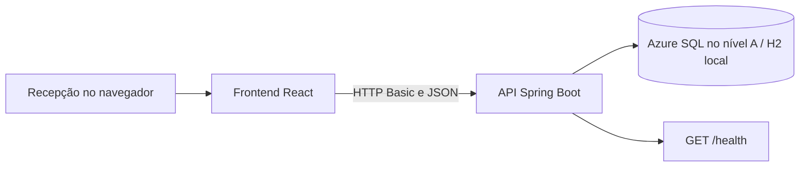

# Agenda do Salão-Escola

Aplicação do **Cloud Challenge — Desafio 03** para consultar a agenda diária de um salão-escola, criar e cancelar atendimentos e impedir dois agendamentos ativos no mesmo horário para a mesma profissional.

## Equipe

| Integrantes | Frente | Entregas |
|---|---|---|
| Joelson e Tayana | Desenvolvimento | API, interface web e integração das funcionalidades. |
| Homero e César | Dados | Modelo relacional, scripts SQL, catálogo fictício e validação da persistência. |
| Lucas | Nuvem | Configuração de ambiente e implantação Azure do nível A escolhido pelo grupo. |
| Nicolas e Morgana | QA e documentação | Casos de teste, evidências, revisão do README e preparação da apresentação. |

## O que o sistema faz

- Lista os serviços, a duração e os profissionais do catálogo fictício.
- Cria agendamento e calcula o horário final pela duração do serviço.
- Impede sobreposição de horários ativos para a mesma profissional (HTTP 409); horários encostados são permitidos.
- Aceita atendimento de segunda a sábado, entre 08h e 20h, no fuso de Brasília, se o serviço couber inteiro no expediente.
- Consulta a agenda diária geral ou filtrada por profissional.
- Cancela sem apagar o histórico; o horário cancelado fica disponível novamente.
- Protege operações com autenticação HTTP Basic e disponibiliza `GET /health` para verificar a conexão ao banco.

## Tecnologias e pastas

- `frontend/`: React 19 e Vite 8 (Node.js 22.12 ou superior).
- `backend/`: Java 21, Spring Boot 3.5, Spring Data JPA, Spring Security e validação. O JAR recebe também o front-end compilado.
- `banco/`: schema e catálogo inicial SQL. A execução local usa H2 persistente.
- `.github/workflows/ci.yaml`: testes e build do backend e frontend, além de verificações de segurança.
- `docs/`: decisões arquiteturais e instruções do projeto.
- `evidencias/`: índice dos registros que o grupo ainda precisa capturar durante a demonstração.



## Rodar localmente no Windows PowerShell

Pré-requisitos: Java 21, Maven 3.9 ou superior, Node.js 22.12 ou superior e npm.

1. No terminal, vá para `backend` e inicie a API:

   ```powershell
   cd backend
   $env:APP_USERNAME = 'recepcionista'
   $env:APP_PASSWORD = 'troque-esta-senha-local'
   mvn spring-boot:run
   ```

   Na primeira execução, o Spring cria `backend/data/agenda-salao.mv.db` e carrega `banco/schema.sql` e `banco/dados-iniciais.sql`.

2. Em outro terminal, instale e inicie a interface:

   ```powershell
   cd frontend
   npm ci
   npm run dev
   ```

3. Abra `http://localhost:5173`, informe as credenciais definidas no primeiro terminal e use clientes fictícios. O proxy do Vite encaminha `/api` para `http://localhost:8080`.

Para gerar o JAR único usado no Azure, compile o front-end (`npm run build` em `frontend/`) antes do Maven. O Spring serve a página compilada e a API pelo mesmo endereço.

Para apagar os dados de demonstração e começar de novo, pare a API e remova o arquivo `backend/data/agenda-salao.mv.db`.

## API

As rotas de negócio exigem HTTP Basic. O endpoint de saúde é público.

| Método e rota | Uso |
|---|---|
| `GET /health` | Estado da aplicação e conexão do banco. |
| `GET /api/health` | Mesmo teste de saúde sob o prefixo usado pela interface. |
| `GET /servicos` | Catálogo de serviços e duração. |
| `GET /api/servicos` | Mesmo catálogo, para o front-end hospedado junto da API. |
| `GET /profissionais` | Catálogo de profissionais fictícios. |
| `POST /agendamentos` | Criar atendimento; recebe `cliente`, `servicoId`, `profissionalId` e `dataHoraInicio` ISO 8601 com fuso. |
| `GET /agendamentos?data=AAAA-MM-DD` | Agenda do dia; `profissionalId` é um filtro opcional. |
| `PATCH /agendamentos/{id}/cancelamento` | Cancela mantendo o registro no histórico. |
| `GET /swagger-ui.html` | Documentação interativa da API. |

Respostas principais: `201` ao criar, `200` ao consultar/cancelar, `400` para entrada/regra inválida, `401` sem credenciais válidas, `404` para IDs inexistentes e `409` para choque de horário ou cancelamento duplicado.

## Banco e variáveis

Por padrão, o backend abre um H2 em arquivo, com usuário `sa` e senha vazia, para facilitar a demonstração local. O usuário HTTP é `recepcionista`; defina `APP_PASSWORD` antes de iniciar.

Variáveis suportadas: `DATABASE_URL` (JDBC URL), `DATABASE_USERNAME`, `DATABASE_PASSWORD`, `APP_USERNAME`, `APP_PASSWORD`, `CORS_ALLOWED_ORIGINS` e `PORT`. O arquivo `.env.example` mostra nomes e exemplos locais; o Spring não carrega `.env` automaticamente. Não publique senhas, connection strings reais, dados pessoais ou arquivos do banco.

Os scripts locais em `banco/schema.sql` e `banco/dados-iniciais.sql` são para H2. O nível A usa versões próprias para Azure SQL em `banco/schema-azure-sql.sql` e `banco/dados-iniciais-azure-sql.sql`.

## Azure — nível A escolhido pelo grupo

O grupo escolheu o nível A: aplicação no Azure App Service e Azure SQL gerenciado pelo grupo. O JAR está publicado e a URL `https://agenda-salao-escola-jj-hwdra6czavawczht.brazilsouth-01.azurewebsites.net` respondeu; `/api/health` informou `UP` e banco conectado. Os sete casos de aceite passaram na nuvem, e a reserva fictícia persistiu após reiniciar o App Service. Recursos observados usam planos/ofertas gratuitos com excedentes do banco desativados. Veja [docs/deploy-azure.md](docs/deploy-azure.md) para os detalhes e pendências de evidência.

### Modelo e decisão

O modelo tem `servicos` (duração), `profissionais` e `agendamentos`. Cada agendamento referencia um serviço e um profissional, guarda início, fim e estado (`ATIVO` ou `CANCELADO`), e tem restrições de duração positiva, estado permitido e chaves estrangeiras. A aplicação calcula o fim e valida sobreposição, expediente e dia de atendimento.

Para desenvolvimento, usamos H2 em arquivo; no nível A, Azure SQL fornece banco relacional gerenciado e persistência fora do computador local. Essa escolha facilita executar o projeto localmente e atende ao uso de banco gerenciado na nuvem, mas exige manter configuração e scripts específicos para SQL Server.

### Estado dos requisitos

| Requisito | Estado conhecido |
|---|---|
| Criar, consultar e cancelar agendamentos | Implementado e coberto por testes automatizados locais |
| Impedir conflito, respeitar expediente e calcular duração | Implementado e coberto por testes automatizados locais |
| Persistência local | H2 em arquivo; teste separado cobre persistência local |
| Persistência no Azure e reinício do App Service | Confirmada: a reserva continuou após mudança de `iniciado_em` |
| Consulta SQL direta | Confirmada; registro da consulta em `evidencias/consulta-sql.txt` |
| Capturas de tela da prova de persistência com data/hora | Pendentes de anexar pelo grupo |
| Registro `GXX-PALAVRA` com a palavra anunciada | O marcador literal usado nos testes deve ser substituído pelo código real do grupo e palavra do dia |
| Teste do código `PROF-HHMM` (nível A) | Depende do cadastro do professor durante o teste |
| Vídeo da apresentação | Pendente de gravação pelo grupo |

O roteiro de apresentação está em [`docs/pitch.md`](docs/pitch.md); quando o grupo gravar e publicar o vídeo, insira o link aqui.

### Dificuldade superada e limitações

Na implantação, os scripts H2 não eram compatíveis com o Azure SQL e o inicializador do Spring separava comandos do SQL Server pelo ponto e vírgula. A solução foi manter scripts T-SQL próprios e configurar `@@` como separador no perfil Azure. Também foi necessário configurar o App Service para iniciar o JAR publicado em `/home/site/wwwroot/app.jar`.

O catálogo é fictício e carregado por script; a atividade não pede telas para cadastrar serviços ou profissionais. O banco gratuito pode pausar automaticamente e demorar na primeira conexão. As capturas da prova de persistência e o vídeo ainda precisam ser anexados. No nível A, o professor fará o teste com o código `PROF-HHMM`.

O Azure SQL está no endpoint público conforme o roteiro da atividade: a aplicação precisa acessar serviços Azure e o grupo precisa consultar o banco a partir do IP liberado para teste. As credenciais ficam nas configurações do App Service, fora do repositório.

## Testes, tarefas e evidências

Em `frontend/`, execute `npm ci`, `npm test` e `npm run build`; depois execute `mvn -f backend/pom.xml verify` na raiz para testar e empacotar o backend com o front-end. O CI faz a mesma sequência em cada push e pull request.

O roteiro de QA está em [`docs/testes.md`](docs/testes.md). O grupo ainda precisa anexar as capturas da demonstração e o vídeo listado em [`evidencias/README.md`](evidencias/README.md); os resultados já observados estão descritos sem substituir essas evidências visuais.

## Sprints propostas

1. **Base e persistência:** confirmar nível/arquitetura, modelo e seed; executar API; demonstrar cadastro e consulta persistidos.
2. **Regras e interface:** agenda por data/profissional, criação, conflito, cancelamento, validações e interface integrada.
3. **QA e entrega:** testes e build verdes; implantação no nível atribuído; teste de persistência após reinício; evidências, revisão do README e pitch gravado.

As sprints organizam as Issues; cada pessoa deve mover os próprios itens no GitHub Project e referenciar a Issue no pull request/commit relacionado.
