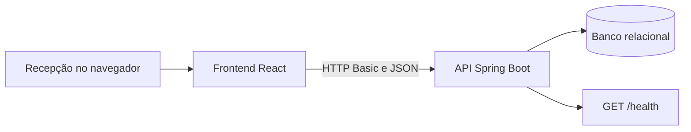

# Agenda do Salão-Escola

Aplicação do **Cloud Challenge — Desafio 03** para consultar a agenda diária de um salão-escola, criar e cancelar atendimentos e impedir dois agendamentos ativos no mesmo horário para a mesma profissional.

## Equipe

| Integrantes | Frente | Entregas |
|---|---|---|
| Joelson e Tayana | Desenvolvimento | API, interface web e integração das funcionalidades. |
| Homero e César | Dados | Modelo relacional, scripts SQL, catálogo fictício e validação da persistência. |
| Lucas | Nuvem | Configuração de ambiente, plano e implantação Azure conforme o nível definido pelo professor. |
| Nicolas e Morgana | QA e documentação | Casos de teste, evidências, revisão do README e preparação da apresentação. |

## O que o sistema faz

- Lista os serviços, a duração e os profissionais do catálogo fictício.
- Cria agendamento e calcula o horário final pela duração do serviço.
- Impede sobreposição de horários ativos para a mesma profissional (HTTP 409); horários encostados são permitidos.
- Aceita atendimento de segunda a sábado, entre 08h e 20h, no fuso de Brasília, se o serviço couber inteiro no expediente.
- Consulta a agenda diária geral ou filtrada por profissional.
- Cancela sem apagar o histórico; o horário cancelado fica disponível novamente.
- Protege operações com autenticação HTTP Basic e disponibiliza `GET /health` para verificar a conexão ao banco.

## Tecnologias e pastas

- `frontend/`: React 19 e Vite 8 (Node.js 22.12 ou superior).
- `backend/`: Java 21, Spring Boot 3.5, Spring Data JPA, Spring Security e validação.
- `banco/`: schema e catálogo inicial SQL. A execução local usa H2 persistente.
- `.github/workflows/ci.yaml`: testes e build do backend e frontend, além de verificações de segurança.
- `docs/`: decisões arquiteturais e instruções do projeto.
- `evidencias/`: índice dos registros que o grupo ainda precisa capturar durante a demonstração.



## Rodar localmente no Windows PowerShell

Pré-requisitos: Java 21, Maven 3.9 ou superior, Node.js 22.12 ou superior e npm.

1. No terminal, vá para `backend` e inicie a API:

   ```powershell
   cd backend
   $env:APP_USERNAME = 'recepcionista'
   $env:APP_PASSWORD = 'troque-esta-senha-local'
   mvn spring-boot:run
   ```

   Na primeira execução, o Spring cria `backend/data/agenda-salao.mv.db` e carrega `banco/schema.sql` e `banco/dados-iniciais.sql`.

2. Em outro terminal, instale e inicie a interface:

   ```powershell
   cd frontend
   npm ci
   npm run dev
   ```

3. Abra `http://localhost:5173`, informe as credenciais definidas no primeiro terminal e use clientes fictícios. O proxy do Vite encaminha `/api` para `http://localhost:8080`.

Para apagar os dados de demonstração e começar de novo, pare a API e remova o arquivo `backend/data/agenda-salao.mv.db`.

## API

As rotas de negócio exigem HTTP Basic. O endpoint de saúde é público.

| Método e rota | Uso |
|---|---|
| `GET /health` | Estado da aplicação e conexão do banco. |
| `GET /servicos` | Catálogo de serviços e duração. |
| `GET /profissionais` | Catálogo de profissionais fictícios. |
| `POST /agendamentos` | Criar atendimento; recebe `cliente`, `servicoId`, `profissionalId` e `dataHoraInicio` ISO 8601 com fuso. |
| `GET /agendamentos?data=AAAA-MM-DD` | Agenda do dia; `profissionalId` é um filtro opcional. |
| `PATCH /agendamentos/{id}/cancelamento` | Cancela mantendo o registro no histórico. |
| `GET /swagger-ui.html` | Documentação interativa da API. |

Respostas principais: `201` ao criar, `200` ao consultar/cancelar, `400` para entrada/regra inválida, `401` sem credenciais válidas, `404` para IDs inexistentes e `409` para choque de horário ou cancelamento duplicado.

## Banco e variáveis

Por padrão, o backend abre um H2 em arquivo, com usuário `sa` e senha vazia, para facilitar a demonstração local. O usuário HTTP é `recepcionista`; defina `APP_PASSWORD` antes de iniciar.

Variáveis suportadas: `DATABASE_URL` (JDBC URL), `DATABASE_USERNAME`, `DATABASE_PASSWORD`, `APP_USERNAME`, `APP_PASSWORD`, `CORS_ALLOWED_ORIGINS` e `PORT`. O arquivo `.env.example` mostra nomes e exemplos locais; o Spring não carrega `.env` automaticamente. Não publique senhas, connection strings reais, dados pessoais ou arquivos do banco.

Os scripts em `banco/` usam recursos de H2 e sintaxe próxima de SQL padrão; antes de conectá-los a PostgreSQL ou Azure SQL, confira as diferenças anotadas no schema e execute os testes no banco escolhido. A configuração atual de execução e teste é H2.

## Nível de nuvem e limite atual

O material da atividade define os níveis A, B e C, mas não registra qual foi atribuído a este grupo. Essa confirmação vem da distribuição do professor. Até o grupo confirmar o nível, o repositório não presume uma arquitetura Azure nem declara uma implantação como concluída:

- **A:** aplicação no Azure App Service e banco criado/gerenciado pelo grupo.
- **B:** banco compartilhado do professor; aplicação em App Service ou local, conforme orientação.
- **C:** execução local; README deve trazer o plano de implantação Azure.

Não foram criados recursos Azure nem custos de nuvem. Depois da confirmação do nível, Lucas pode completar a configuração e o grupo registra URL e evidência reais.

## Testes, tarefas e evidências

Execute `mvn -f backend/pom.xml verify` para validar e empacotar o backend; em `frontend/`, execute `npm ci`, `npm test` e `npm run build`. O CI repete os testes e builds em cada push e pull request.

O roteiro de QA está em [`docs/testes.md`](docs/testes.md). A lista das evidências que ainda precisam ser produzidas durante a execução está em [`evidencias/README.md`](evidencias/README.md). Não marque implantação, persistência após reinício ou apresentação como comprovadas sem capturar a demonstração correspondente.

## Sprints propostas

1. **Base e persistência:** confirmar nível/arquitetura, modelo e seed; executar API; demonstrar cadastro e consulta persistidos.
2. **Regras e interface:** agenda por data/profissional, criação, conflito, cancelamento, validações e interface integrada.
3. **QA e entrega:** testes e build verdes; implantação no nível atribuído; teste de persistência após reinício; evidências, revisão do README e pitch gravado.

As sprints organizam as Issues; cada pessoa deve mover os próprios itens no GitHub Project e referenciar a Issue no pull request/commit relacionado.
