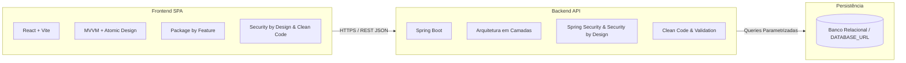

# Documentação do Projeto - Agenda do Salão-Escola

Bem-vindo à documentação técnica e arquitetural do projeto **Agenda do Salão-Escola** (Cloud Challenge).

---

## 📚 Conteúdo da Documentação

- **[Decisões de Arquitetura (ADRs)](adr/README.md)**: Registros formais de decisões arquiteturais para o Frontend e Backend.
  - **[Frontend ADRs](adr/frontend/)**:
    - [ADR-001: React + React DOM + Vite](adr/frontend/ADR-001-stack-react-vite.md)
    - [ADR-002: Padrão Arquitetural MVVM](adr/frontend/ADR-002-arquitetura-mvvm.md)
    - [ADR-003: Design Atômico (Atomic Design)](adr/frontend/ADR-003-design-atomico.md)
    - [ADR-004: Modularização Package by Feature](adr/frontend/ADR-004-organizacao-package-by-feature.md)
    - [ADR-005: Diretrizes de Clean Code no Frontend](adr/frontend/ADR-005-clean-code-frontend.md)
    - [ADR-006: Security by Design no Frontend](adr/frontend/ADR-006-security-by-design-frontend.md)
  - **[Backend ADRs](adr/backend/)**:
    - [ADR-001: Plataforma Spring Boot](adr/backend/ADR-001-stack-spring-boot.md)
    - [ADR-002: Arquitetura em Camadas (Layered Architecture)](adr/backend/ADR-002-arquitetura-em-camadas.md)
    - [ADR-003: Spring Security e Security by Design](adr/backend/ADR-003-spring-security-security-by-design.md)
    - [ADR-004: Diretrizes de Clean Code no Backend](adr/backend/ADR-004-clean-code-backend.md)

---

## 🎯 Resumo da Arquitetura Escolhida

