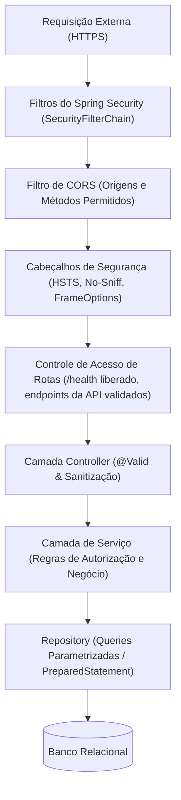

# ADR-003: Segurança com Spring Security e Security by Design no Backend

- **Status**: Aceito
- **Data**: 04/11/2026
- **Decisores**: Equipe de Desenvolvimento
- **Área**: Backend

---

## 1. Contexto

A API da **Agenda do Salão-Escola** será implantada na nuvem pública (Azure App Service) e manipulará agendamentos e dados de serviços e profissionais.

O edital e os requisitos do desafio exigem explicitamente:
1. Validar rigorosamente todas as entradas no servidor.
2. Usar exclusivamente consultas parametrizadas contra injeção de código.
3. Manter a string de conexão na variável de ambiente `DATABASE_URL` e **nunca versionar arquivos `.env` ou credenciais**.
4. Disponibilizar o endpoint `GET /health` para verificação de integridade e conectividade.
5. Retornar erros com respostas estruturadas sem expor detalhes internos da infraestrutura.

A segurança deve ser um pilar intrínseco da arquitetura (**Security by Design**), implementada com o suporte do **Spring Security**.

---

## 2. Decisão

Adotar o **Spring Security** em conjunto com os princípios de **Security by Design** e **Defense in Depth**:

### Pilares de Segurança Implementados:

### 2.1. Configuração do Spring Security (`SecurityFilterChain`)
- **API Stateless**: Como a comunicação primária da API segue o padrão REST, sessões com estado (`HttpSession`) são desabilitadas (`SessionCreationPolicy.STATELESS`).
- **Política de CSRF**: Desabilitada para endpoints REST estritamente stateless ou implementada via Cookie CSRF Token se houver autenticação baseada em sessão.
- **Autorização de Rotas**:
  - `GET /health`: Acesso público permitido para monitoramento da Azure e checagem de integridade.
  - Endpoints de negócio (`/agendamentos/**`, `/profissionais/**`, `/servicos/**`): Protegidos e validados conforme a matriz de acesso.

### 2.2. Política de CORS (Cross-Origin Resource Sharing)
- O Spring Security conterá um `CorsConfigurationSource` explícito.
- Permitirá apenas as origens autorizadas (ex: URL do frontend React implantado na Azure e `localhost:5173` em ambiente de desenvolvimento).
- Métodos restritos aos necessários (`GET`, `POST`, `PUT`, `PATCH`, `DELETE`, `OPTIONS`).

### 2.3. Prevenção Absoluta Contra SQL Injection
- Todas as operações com banco de dados devem utilizar o Spring Data JPA ou queries explicitamente parametrizadas (`PreparedStatement` / `@Param`).
- **Proibição Estrita de Concatenação de SQL**: É terminantemente proibido concatenar strings com entradas do usuário para montar cláusulas SQL.

### 2.4. Validação Rigorosa no Servidor (Zero Trust)
- Todos os endpoints `@PostMapping` e `@PutMapping` utilizam anotações do Jakarta Bean Validation:
  - `@NotBlank`, `@Size(max = ...)` para nomes de clientes e strings.
  - `@NotNull`, `@Positive` para IDs de serviços e profissionais.
  - `@FutureOrPresent` para início do agendamento.
- Validação no Service de intervalos (15 a 240 minutos para serviços, horário entre 08:00 e 20:00, segunda a sábado).

### 2.5. Não Divulgação de Informações Sensíveis (Information Disclosure)
- Exceções internas (como `SQLException` ou `DataAccessException`) nunca são expostas ao cliente HTTP.
- O `@RestControllerAdvice` captura todas as falhas e retorna payloads estruturados padrão (ex: RFC 7807 Problem Details ou DTO padronizado com campos `timestamp`, `status`, `error`, `message` e `path`), ocultando stack traces e versões de software.

### 2.6. Gerenciamento de Credenciais e Segredos
- A string de conexão é lida exclusivamente da variável de ambiente `DATABASE_URL` (definida no Azure App Service Configuration ou localmente em arquivo `.env` ignorado pelo `.gitignore`).
- Arquivos `.env` e certificados são listados obrigatoriamente no `.gitignore`.

---

## 3. Justificativa

1. **Atendimento Direto aos Requisitos do Desafio**: Cumpre a exigência de segredo zero no código-fonte e sanitização de dados.
2. **Mitigação do OWASP Top 10**: Proteção contra injeção de comandos, quebra de controle de acesso, falhas criptográficas e má configuração de segurança.
3. **Resiliência em Produção**: O endpoint `/health` permite ao orquestrador da Azure verificar se a aplicação e a conexão com o banco continuam saudáveis, reiniciando o serviço caso necessário.

---

## 4. Consequências

### Positivas
- Nível de segurança robusto e aderente a padrões corporativos.
- Isolação de credenciais de banco da Azure.
- Mensagens de erro informativas para os desenvolvedores e seguras para os usuários.

### Negativas / Mitigações
- Configurações incorretas de CORS podem bloquear chamadas legítimas do frontend durante o desenvolvimento.
- **Mitigação**: Manter perfis do Spring (`application-dev.properties` e `application-prod.properties`) com regras claras para origens permitidas.

