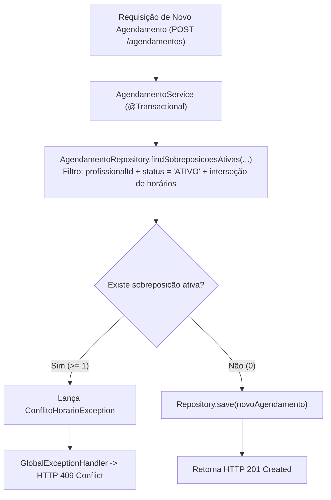

# ADR-006: Estratégia de Banco de Dados (H2) e Local de Validação de Sobreposição de Horários

- **Status**: Aceito
- **Data**: 04/11/2026
- **Decisores**: Equipe de Desenvolvimento
- **Área**: Backend / Banco de Dados

---

## 1. Contexto

Para o desenvolvimento e execução dos testes da **Agenda do Salão-Escola**, era necessário:
1. Escolher o SGBD padrão para desenvolvimento ágil e suporte aos scripts SQL de schema e carga inicial.
2. Decidir formalmente **onde será validada a sobreposição de horários** (aplicação, banco de dados ou ambos), levando em consideração requisições simultâneas e portabilidade entre SGBDs (H2, PostgreSQL e Azure SQL).
3. Garantir que agendamentos cancelados permaneçam persistidos para histórico sem travar o horário correspondente.

---

## 2. Decisão

### 2.1. Adoção do H2 Database
Adotar o **H2 Database** (modo embedded / arquivo ou in-memory) integrado nativamente ao Spring Boot:
- Scripts DDL (`banco/schema.sql`) e DML (`banco/dados-iniciais.sql`) escritos em **ANSI SQL padrão**, compatíveis com H2, PostgreSQL e Azure SQL.
- Permite execução imediata por qualquer membro da equipe e testes automatizados no pipeline sem dependência obrigatória de contêineres Docker locais.

### 2.2. Onde a Sobreposição de Horários é Validada: Camada de Aplicação (Service) com Suporte Transacional
A verificação de sobreposição de horários será executada prioritariamente na **Camada de Aplicação (`AgendamentoService`)**, apoiada por transações (`@Transactional`) e índices de busca no banco.

#### Tratamento de Agendamentos Simultâneos (Concorrência):
- A operação de inserção ocorre dentro de método anotado com `@Transactional`.
- Caso haja necessidade de concorrência extrema entre duas recepcionistas submetendo o mesmo profissional no mesmo milissegundo, a camada de serviço pode aplicar bloqueio pessimista (`Pessimistic Lock`) no profissional ou nível de isolamento transacional adequado.

#### Por que não colocar a restrição de sobreposição unicamente no Banco?
- Restrições do tipo `EXCLUDE USING gist` são proprietárias do PostgreSQL (dependem da extensão `btree_gist`) e **não existem** no H2 nem no Azure SQL Server.
- Delegar a validação de sobreposição ao `AgendamentoService` garante:
  1. **Portabilidade Universal**: O mesmo código funciona idêntico no H2 local e na nuvem Azure.
  2. **Mensagem Clara e Semântica**: O sistema captura a exceção de domínio e responde com o código semântico `HTTP 409 Conflict` e JSON amigável, sem precisar tratar erros opacos de violação de constraint do driver JDBC.

### 2.3. Manutenção de Cancelamentos no Histórico (Exclusão Lógica)
- A tabela `agendamentos` possui a coluna `status` com valores restritos por constraint (`CHECK (status IN ('ATIVO', 'CANCELADO'))`).
- Ao cancelar, a aplicação executa um `UPDATE agendamentos SET status = 'CANCELADO' WHERE id = :id`.
- A query de conflito filtra **estritamente `WHERE status = 'ATIVO'`**. Logo, registros cancelados permanecem arquivados no banco de dados para auditoria, mas liberam imediatamente o horário para novos agendamentos (atendendo ao Critério CA4).

---

## 3. Justificativa

1. **Simplicidade e Agilidade**: O H2 elimina o atrito de configuração inicial para os desenvolvedores e para o avaliador.
2. **Independência de Fornecedor de Banco**: O schema e as regras de negócio permanecem neutros, facilitando eventual migração entre Azure SQL e PostgreSQL.
3. **Atendimento aos Critérios CA1 a CA4**: Permite demonstrar com facilidade os cenários de conflito (409), horário contíguo (201), profissional diferente (201) e cancelamento liberador (201).

---

## 4. Consequências

### Positivas
- Testes unitários e de integração rápidos e isolados.
- Scripts SQL idempotentes e portáteis em `banco/`.
- Regra de negócio de sobreposição isolada e facilmente testável via Mockito.

### Negativas / Mitigações
- **Banco em memória perde dados ao reiniciar a JVM**:
  - **Mitigação**: Configurar a string `DATABASE_URL` no `application.properties` para modo arquivo persistente (`jdbc:h2:file:./dados/agenda;DB_CLOSE_DELAY=-1`) ou banco relacional gerenciado na Azure.
