# ADR-002: Padrão Arquitetural MVVM (Model-View-ViewModel) no Frontend

- **Status**: Aceito
- **Data**: 04/11/2026
- **Decisores**: Equipe de Desenvolvimento
- **Área**: Frontend

---

## 1. Contexto

Aplicações React frequentemente sofrem com a mistura excessiva de lógica de negócios, chamadas de rede, formatação de datas/moedas e controle de estado dentro dos próprios componentes JSX (efeito "Fat Component" ou "God Component").

No projeto **Agenda do Salão-Escola**, regras como cálculo de horários de término com base na duração do serviço, formatação de horários de funcionamento (08:00 às 20:00), tratamento de códigos de status HTTP (ex: 409 Conflito de Horário) e atualização de status de agendamentos exigem separação nítida entre lógica de apresentação e renderização visual.

---

## 2. Decisão

Adotar o padrão **MVVM (Model-View-ViewModel)** adaptado para o paradigma reativo funcional do React:

```mermaid
flowchart LR
    subgraph Model["Model (Dados & API)"]
        M1["Types / Interfaces"]
        M2["API Services (fetch/axios)"]
    end

    subgraph ViewModel["ViewModel (Custom Hook)"]
        VM1["useAgendamentosViewModel"]
        VM2["Estados (useState, useReducer)"]
        VM3["Handlers & Validações de UI"]
    end

    subgraph View["View (Componentes React)"]
        V1["Componentes de Apresentação (JSX)"]
        V2["Atomic Design (Molecules/Organisms)"]
    end

    Model -->|Fornece dados brutos| ViewModel
    ViewModel -->|Ações assíncronas| Model
    ViewModel -->|Expõe dados formatados e handlers| View
    View -->|Dispara eventos de usuário| ViewModel
```

### Divisão de Responsabilidades:

1. **Model**:
   - Representa os tipos/interfaces de dados (`Agendamento`, `Servico`, `Profissional`).
   - Serviços de comunicação com a API backend (endpoints REST, parsing e tratamento inicial de resposta HTTP).
   - Não depende de nenhuma camada visual ou do React.

2. **ViewModel (Custom Hooks)**:
   - Implementado através de Custom Hooks (ex: `useAgendamentoViewModel()`).
   - Gerencia estados da tela (loading, erros, itens selecionados, modais).
   - Executa regras de apresentação (transformação de datas ISO para exibição amigável, formatação de status).
   - Expõe apenas o estado pronto para consumo e funções de ação (`criarAgendamento`, `cancelarAgendamento`).

3. **View**:
   - Componentes React puros (Stateless ou com estado efêmero estritamente visual).
   - Não realizam chamadas de rede diretamente.
   - Consomem o ViewModel via desestruturação de hooks e renderizam a UI declarativa.

---

## 3. Justificativa

1. **Testabilidade Aprimorada**: A lógica contida no ViewModel (Custom Hook) pode ser testada isoladamente usando ferramentas como `@testing-library/react-hooks` sem depender do DOM renderizado.
2. **Reutilização de Lógica**: A mesma lógica de manipulação de agendamentos pode ser reaproveitada em diferentes visões (ex: visão em lista, visão em calendário/timeline).
3. **Desacoplamento Visual**: A equipe de QA e design pode alterar o layout ou estilo sem risco de quebrar a lógica de requisição e validação de regras de agendamento.

---

## 4. Consequências

### Positivas
- Código limpo, legível e manutenível.
- Componentes visuais concisos e fáceis de inspecionar.
- Manutenção da regra de conflito HTTP 409 centralizada no ViewModel com mensagens claras para o usuário.

### Negativas / Mitigações
- **Boilerplate Adicional**: Para formulários simples, a criação de arquivos separados (Model, ViewModel e View) requer mais arquivos.
- **Mitigação**: Manter a estrutura proporcional à complexidade de cada feature e adotar convenções unificadas dentro do `package-by-feature`.

