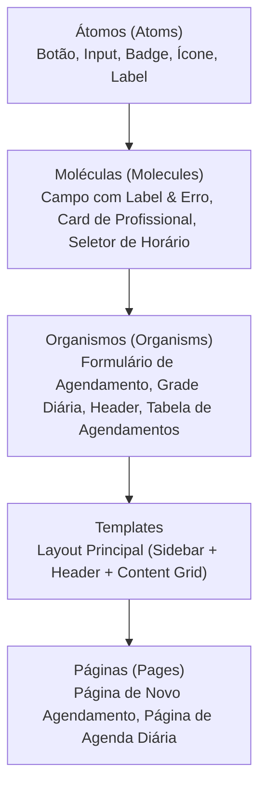

# ADR-003: Metodologia Atomic Design para Interface e Componentes

- **Status**: Aceito
- **Data**: 04/11/2026
- **Decisores**: Equipe de Desenvolvimento
- **Área**: Frontend

---

## 1. Contexto

A interface da **Agenda do Salão-Escola** possui múltiplos elementos visuais reutilizáveis em diferentes fluxos: botões de ação (Criar, Cancelar), badges de status (`Ativo`, `Cancelado`), seletores de profissionais e serviços, e cartões de agendamento na grade diária.

Sem uma metodologia clara de hierarquia de componentes, projetos frontend frequentemente enfrentam inconsistência visual, duplicação de CSS e componentes com granularidade arbitrária ("componentes monstros" misturados com elementos minúsculos sem padrão).

---

## 2. Decisão

Adotar a metodologia **Atomic Design** (proposta por Brad Frost) para a organização, composição e reuso dos componentes visuais do frontend.

### Níveis da Metodologia:

1. **Átomos (`atoms/`)**:
   - Blocos fundamentais e indivisíveis de UI.
   - Exemplos: `Button`, `Input`, `Select`, `Badge` (para status ativo/cancelado), `Typography`.
   - Propriedades altamente genéricas; não possuem regras de negócio.

2. **Moléculas (`molecules/`)**:
   - Grupos de átomos unidos para funcionar como uma unidade funcional simples.
   - Exemplos: `FormField` (Label + Input + Mensagem de Erro), `ProfessionalCardSelect`, `TimeSlotPill`.

3. **Organismos (`organisms/`)**:
   - Estruturas visuais complexas compostas por moléculas e átomos.
   - Exemplos: `AppointmentForm` (formulário completo com seleção de serviço, profissional e horário), `DailyScheduleGrid` (grade diária com marcação de horários ocupados/livres).

4. **Templates (`templates/`)**:
   - Estruturas de layout da página (esqueleto wireframe), posicionando organismos na tela sem dados reais estáticos.
   - Exemplo: `DashboardLayout` (Navbar superior, menu lateral e container central responsivo).

5. **Páginas (`pages/`)**:
   - Instâncias concretas dos templates onde o conteúdo real é injetado via ViewModel.
   - Exemplo: `SchedulePage` (exibe a agenda do dia selecionado consumindo a API).

---

## 3. Justificativa

1. **Consistência Visual e Reusabilidade**: Garante que o mesmo badge de status e o mesmo botão sejam utilizados em toda a plataforma.
2. **Escalabilidade da UI**: Facilita a expansão da aplicação caso novos módulos (ex: gestão de clientes, relatórios de produtividade) sejam adicionados.
3. **Facilidade para QA e Testes**: Átomos e moléculas podem ser testados unitariamente de forma visual e funcional com facilidade.

---

## 4. Consequências

### Positivas
- Código visual previsível e desacoplado de dados de negócio.
- Eliminação de duplicações de estilo e marcação HTML.
- Fácil integração com a abordagem de `package-by-feature` (componentes globais no shared e componentes locais no feature).

### Negativas / Mitigações
- **Risco de Overengineering**: Criar abstrações excessivas para elementos de uso único.
- **Mitigação**: Criar átomos e moléculas compartilhados apenas quando houver reuso comprovado ou valor estrutural evidente.

