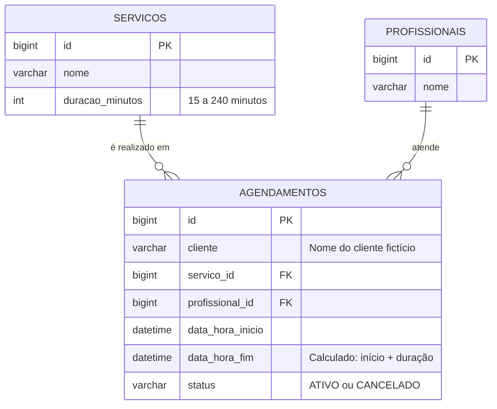
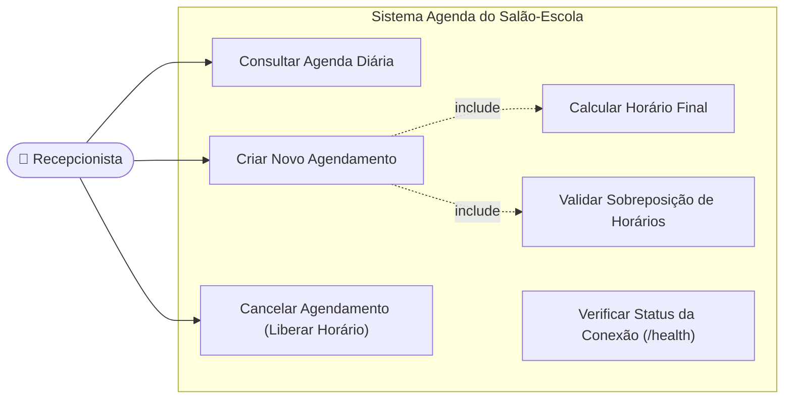
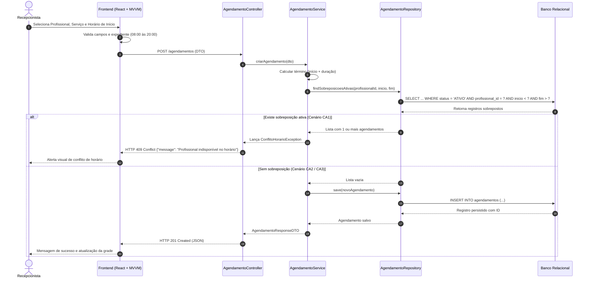
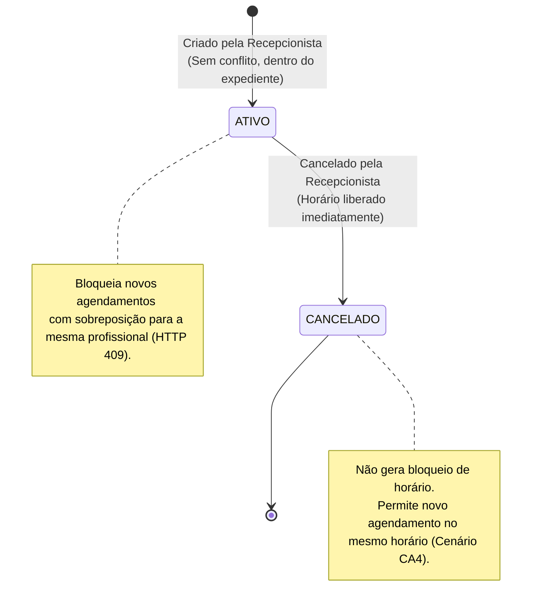

# Critérios de Aceitação e Modelos Visuais (CA1 a CA5)

Este documento apresenta a matriz de critérios de aceitação fundamentais do Desafio 03 acompanhada dos modelos e diagramas visuais do sistema para a **Agenda do Salão-Escola**.

---

## 🎯 1. Tabela de Critérios de Aceitação (CA1 a CA5)

| ID | Cenário | Ação da Recepcionista | Comportamento do Sistema | Status HTTP Esperado |
|---|---|---|---|---|
| **CA1** | **Conflito de Horário para a mesma profissional** | Tenta agendar para **Ana** às **14:15** (Ana já possui agendamento ativo das 14:00 às 14:30). | Sistema detecta sobreposição no intervalo [14:00, 14:30] e recusa o agendamento. | `409 Conflict` |
| **CA2** | **Horário contíguo (encostado no término)** | Tenta agendar para **Ana** às **14:30** (Ana encerra atendimento anterior exatamente às 14:30). | Sistema aceita o agendamento, pois horários contíguos não geram sobreposição. | `201 Created` |
| **CA3** | **Horário idêntico para profissional diferente** | Tenta agendar para **Bruno** às **14:15** (enquanto Ana está ocupada no mesmo horário). | Sistema aceita o agendamento, pois o bloqueio é exclusivo por profissional. | `201 Created` |
| **CA4** | **Cancelamento liberando horário** | Cancela o agendamento de **Ana** das 14:00 às 14:30 e tenta novo agendamento para Ana às **14:00**. | Sistema aceita o novo agendamento, pois o status cancelado libera o horário anterior. | `201 Created` |
| **CA5** | **Fora de expediente ou em dia inválido** | Tenta agendar serviço de 45 min às **19:45** (terminaria às 20:30) ou agendar no **domingo**. | Sistema recusa imediatamente por violação das regras de horário comercial e dias úteis. | `400 Bad Request` |

---

## 📊 2. Modelo Entidade-Relacionamento (ERD)



---

## 👤 3. Diagrama de Casos de Uso (Recepcionista)



---

## 🔄 4. Diagrama de Sequência: Fluxo de Agendamento e Conflito (CA1 e CA2)



---

## 🔁 5. Diagrama de Ciclo de Vida do Agendamento (Máquina de Estados)



---

## ⏱️ 6. Representação Visual da Linha do Tempo (Conflitos vs Permissões)

```text
Atendimento Existente (Ana):
[ 14:00 =================== 14:30 ] (ATIVO)

Tentativa 1 (CA1): Novo agendamento para Ana às 14:15 (Duração 30m)
        [ 14:15 ======== 14:45 ]
        ---> SOBREPOSIÇÃO DETECTADA! Recusar com HTTP 409 Conflict.

Tentativa 2 (CA2): Novo agendamento para Ana às 14:30 (Duração 30m)
                                [ 14:30 ======== 15:00 ]
                                ---> CONTÍGUO (SEM INTERSEÇÃO). Aceitar com HTTP 201 Created.

Tentativa 3 (CA3): Novo agendamento para Bruno às 14:15 (Duração 30m)
        [ 14:15 ======== 14:45 ] (Bruno)
        ---> OUTRO PROFISSIONAL. Aceitar com HTTP 201 Created.

Tentativa 4 (CA4): Cancelamento de Ana (14:00-14:30 passa para CANCELADO)
[ 14:00 ------------------- 14:30 ] (CANCELADO)
Novo agendamento para Ana às 14:00 (Duração 30m)
[ 14:00 =================== 14:30 ] (NOVO ATIVO)
---> HORÁRIO LIBERADO. Aceitar com HTTP 201 Created.
```
